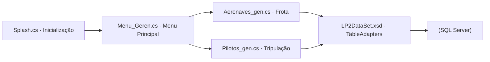

<p align="center">
  
</p>

<h1 align="center">Sistema-Gerenciar-V-os</h1>

<p align="center">Aplicação desktop para cadastro e gerenciamento de aeronaves e pilotos.</p>

<p align="center">
  
  
  
</p>

<p align="center"><a href="#visão-geral">Visão geral</a> &nbsp;·&nbsp; <a href="#recursos">Recursos</a> &nbsp;·&nbsp; <a href="#como-executar">Como executar</a></p>

---

## Visão geral

O projeto implementa um fluxo completo de aplicação desktop clássica: tela de abertura animada (Splash), painel principal de navegação (Menu_Geren), formulários especializados (Aeronaves_gen e Pilotos_gen) e camada de persistência fortemente tipada com LP2DataSet (XSD).

## Recursos

| Recurso | Como funciona |
|---|---|
| Tela de Inicialização (Splash) | Formulário de carregamento inicial antes de liberar o menu principal do sistema. |
| Painel Central (Menu_Geren) | Hub de navegação que conecta o operador aos módulos de frota e tripulação. |
| Gestão de Frota (Aeronaves_gen) | Cadastro, consulta, atualização e exclusão de aeronaves vinculadas ao banco de dados. |
| Gestão de Tripulação (Pilotos_gen) | Controle completo dos registros de pilotos habilitados na operação. |
| DataSet Tipado (LP2DataSet.xsd) | Mapeamento do schema SQL Server com TableAdapters para operações seguras de leitura e escrita. |

<details>
<summary>Arquitetura</summary>



</details>

<details>
<summary>Estrutura do repositório</summary>

```text
Sistema-Gerenciar-V-os/
├── assets/
│   └── project-animal.png          Emblema do projeto
├── WfaDS/
│   ├── Splash.cs                   Tela inicial de abertura do sistema
│   ├── Menu_Geren.cs               Menu principal de navegação
│   ├── Aeronaves_gen.cs            Formulário de gerenciamento de aeronaves
│   ├── Pilotos_gen.cs              Formulário de gerenciamento de pilotos
│   ├── LP2DataSet.xsd              Schema tipado e TableAdapters do SQL Server
│   ├── App.config                  String de conexão e configurações de runtime
│   └── Program.cs                  Ponto de entrada da aplicação desktop
├── WfaDS.sln                       Solução Visual Studio
└── README.md
```

</details>

## Como executar

1. Clone o repositório no Windows:
   ```powershell
   git clone https://github.com/arthurlynow098/Sistema-Gerenciar-V-os.git
   ```
2. Abra WfaDS.sln no **Visual Studio** e verifique a string de conexão do SQL Server no arquivo WfaDS/App.config.
3. Compile e inicie a aplicação pressionando **F5**.

---

<p align="center">
  <a href="https://github.com/arthurlynow098">GitHub</a> &nbsp;·&nbsp;
  <a href="https://arthurentsev.vercel.app/">Portfólio</a> &nbsp;·&nbsp;
  <a href="https://www.linkedin.com/in/entsevarthur/">LinkedIn</a>
</p>
